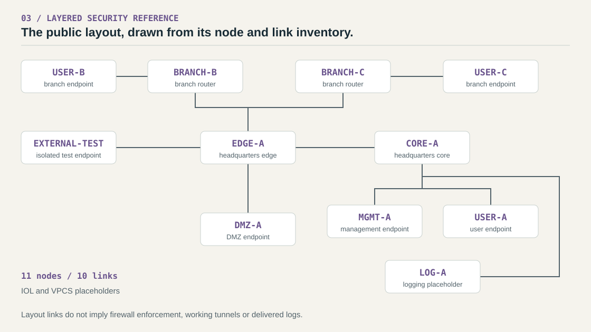
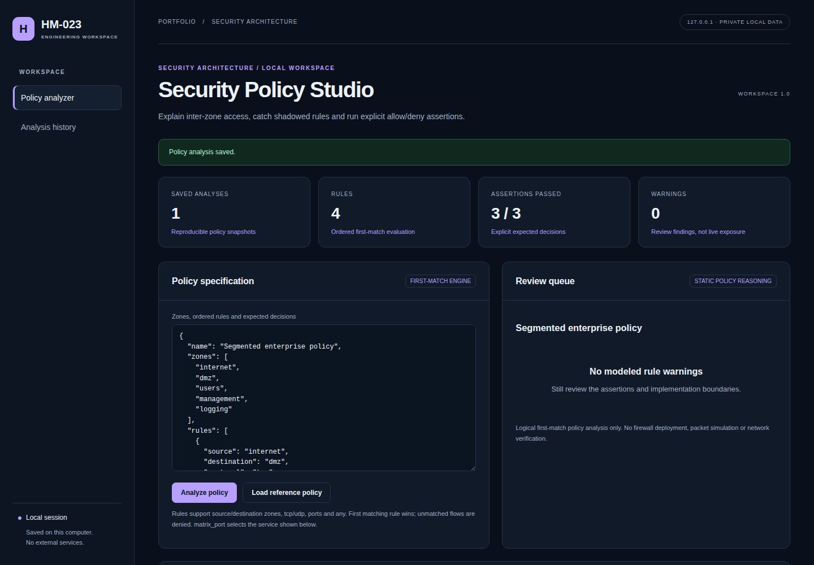

# Defense in Depth Architecture

A layered security design built around a concrete question: which zones should be able to reach which services? The repository pairs a reference network layout with a later policy analyzer that makes those expectations executable.

**Security architecture · Segmentation · EVE-NG reference · Python**

[Threat model](docs/threat-model.md) · [Control matrix](docs/security-controls.md) · [Lab setup](docs/deployment.md) · [Example policy](examples/workspace-policy.json)



*Diagram follows the public 11-node inventory. Connections represent layout links, not verified security controls.*

## Start with the boundaries

The [threat model](docs/threat-model.md) covers remote access, compromised endpoints, lateral movement and management exposure. The design uses separate user, management, DMZ and logging segments, with branch networks connected through the headquarters edge.

The [control matrix](docs/security-controls.md) maps each proposed control to evidence: allow/deny records for firewall rules, reachability tests for segmentation, counters for encrypted tunnels, and measured downtime for failover.

The EVE-NG file is a **generic reference layout**, separate from the original collaborative lab. It contains placeholder image names and no device configurations. Compatible images, import, device boot and actual enforcement still need validation.

## Later extension: test the policy

The local Python analyzer evaluates ordered rules using first-match semantics and implicit default deny. It reports matching rule IDs, a zone access matrix, fully shadowed rules and some broad-access warnings.

The included [policy example](examples/workspace-policy.json) makes these assertions:

| Flow | Expected decision | Matching rule |
|---|---|---|
| Internet → DMZ, TCP 443 | Allow | P-01 |
| Internet → management, TCP 22 | Deny | Implicit default deny |
| Users → management, TCP 3389 | Deny | Implicit default deny |

Rule order matters: an earlier broad allow can make a later deny unreachable. The regression tests exercise that case. These are logical decisions over zones, protocols and ports; they do not model stateful sessions or deploy firewall rules.

## Run the checks

Requires Python 3.11+; no third-party Python packages.

```powershell
python topology/validate_topology.py
python -m unittest discover -s tests -v
python -m webapp.app
```

The topology checker validates XML IDs, link references and inventory counts. Open [localhost:8103](http://127.0.0.1:8103), load the reference policy and select **Analyze policy** to inspect the three assertions.

[Topology CI](https://github.com/HM-023/DefenseInDepthArchitecture/actions/workflows/validate-topology.yml) · [Application CI](https://github.com/HM-023/DefenseInDepthArchitecture/actions/workflows/workspace.yml)

<details>
<summary>Policy analyzer screenshot and documentation</summary>



[Analyzer guide](docs/workspace-guide.md) · [Implementation](docs/workspace-architecture.md) · [Verification scope](docs/workspace-verification.md)

</details>

**Status:** static layout checks and logical policy analysis. IDS/IPS, IPsec, AAA, logging delivery and high availability remain design objectives, not implemented controls in this reference.

[Project background](docs/reference-case-study.md) · [Publication notes](PUBLICATION_NOTES.md)
