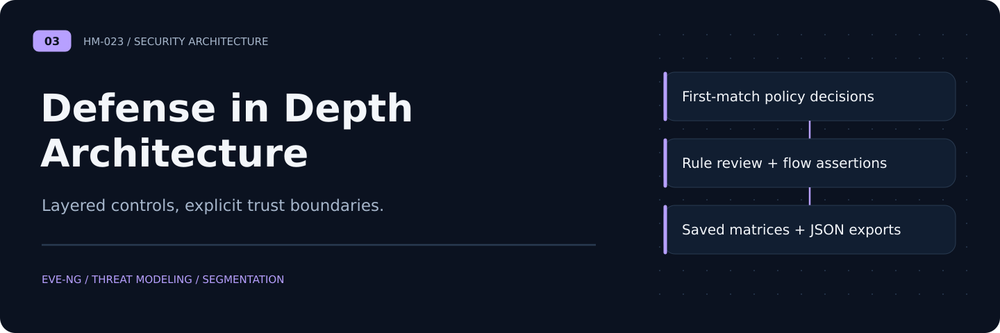
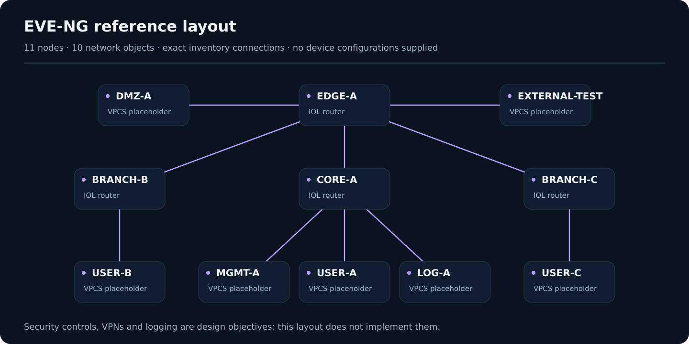

# Defense in Depth Architecture

**Design + static reference layout** · [Portfolio](https://github.com/HM-023) · [Deployment](deployment.md) · [Threat model](threat-model.md) · [Control matrix](security-controls.md)

A multi-site enterprise security architecture case study with a newly authored generic EVE-NG reference layout. The focus is on **layered controls and observable defensive outcomes**, not bypassing security controls.

## Reference layout

## Security objectives

- Separate untrusted, DMZ, internal, management, and branch networks
- Design firewall rules based on explicit allowlists and least privilege
- Protect inter-site communications with appropriately configured encrypted tunnels
- Use centralized identity, logging, alert triage, and documented incident response
- Plan high availability and validate how controls behave during failover

## Included artifacts

- `topology/example-topology.unl` — new fictional 11-node EVE-NG **layout**, requiring your own compatible image mapping
- `topology/inventory.json` — machine-readable reference node and link inventory
- `docs/security-controls.md` — controls-to-validation matrix
- `docs/deployment.md` — prerequisites, design limitations, and reproducibility
- `docs/threat-model.md` — attack surfaces and compensating controls

## Important limitations

The EVE-NG layout is a newly authored generic example, statically checked but **not imported or executed**. Router image names are placeholders; it **contains no appliance firmware, boot images or device configurations**. The inventory lists topology objects, not proof of correct IDS, VPN, AAA, or firewall configuration. These technologies need working configurations, compatible licensed appliances, and independent testing before any implementation claim.

No historical organization names, personal identifiers, assessment documents, or real deployment claims are included. The original shared topology and derived inventory remain private pending contribution and reuse permission checks.
